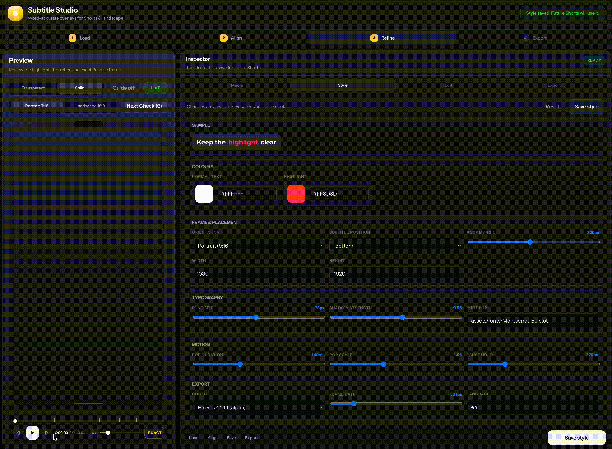

# Subtitle Studio

A free, offline subtitle overlay tool for educational YouTube Shorts and landscape videos.

You provide a voiceover and the SRT you already wrote. The app locks each word to real speech, previews the highlight, and exports a transparent overlay for DaVinci Resolve Free.

**The SRT is the script.** A local speech model only supplies the timing.



## Features

- Word-by-word highlight preview with YouTube-style player controls
- Portrait (9:16) and landscape (16:9) export
- Subtitle position: top, middle, or bottom
- Transparent ProRes 4444 / QuickTime Animation overlay
- Local web UI — no paid API

## What you need

- macOS with Python 3.11 or newer (tested with Python 3.13)
- [FFmpeg](https://ffmpeg.org/) on your PATH (`brew install ffmpeg`)
- About 1 GB of free disk space for the speech model on first align

## Install

```bash
python3 -m venv .venv
source .venv/bin/activate
pip install -r requirements.txt
```

## Use

```bash
source .venv/bin/activate
python run.py
```

Or double-click `Start Subtitle Generator.command`.

The page opens at [http://127.0.0.1:8765](http://127.0.0.1:8765). Leave the terminal window open.

1. Choose the voiceover (WAV or MP3) and the SRT file.
2. Click **Load** / generate word timings.
3. Preview the highlight, correct any flagged words, save.
4. Export the transparent video.

The movie is written to `output/<name>-subs.mov` unless you change the path.

### In DaVinci Resolve Free

1. Import the `.mov`.
2. Put it on a video track above the picture, lined up with the voiceover.
3. Leave the composite mode at Normal.

Default export is ProRes 4444 with alpha. If Resolve shows a black box, set codec to QuickTime Animation (`qtrle`) and export again.

## Style

Style lives in `config.yaml` and in the **Style** inspector tab:

- Font, size, colours, highlight
- Orientation and subtitle position
- Edge margin, motion, frame size, codec

## Command line

```bash
python run.py align --audio voice.wav --srt voice.srt --out work/project.json
python run.py export --project work/project.json --out output/voice-subs.mov
```

## Tests

```bash
.venv/bin/python -m unittest tests/test_core.py
.venv/bin/python tests/check_sync.py
```

## License

MIT. Montserrat Bold is included for consistent exports and is licensed under the SIL Open Font License, Version 1.1.
